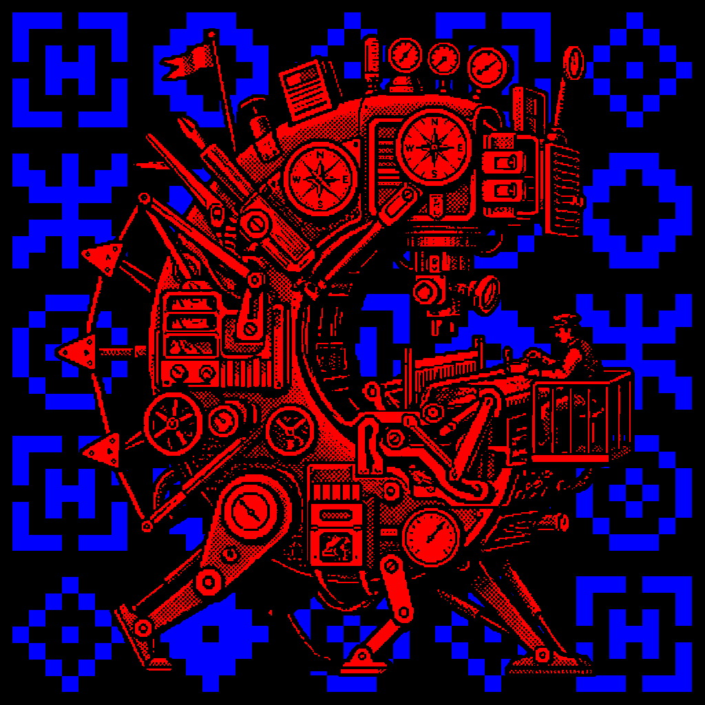
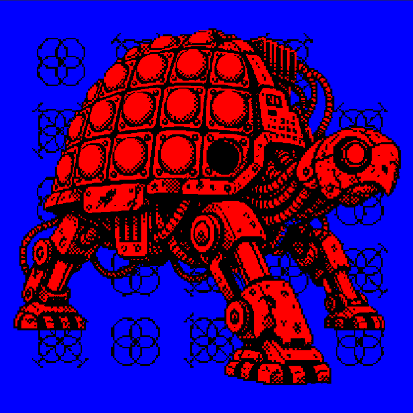

### Hey, I'm Justin 👋

I build software with agents, and I help the engineers I work with do it too. My day job is still .NET and SQL Server at [Veson Nautical](https://veson.com), where I built the shared context my team's agents import and wrote two AI-engineering guides for our engineering knowledge base. Agents write most of my code now, and a finding counts only after it's confirmed in the code. [Here's why that rule exists](https://ideas.heathdev.me/ideas/the-bug-is-in-the-report).

Before Veson: thirteen years leading IT development at [Volition](https://en.wikipedia.org/wiki/Volition_(company)), the studio behind Saints Row and Red Faction, and eight years at Horizon Hobby bridging .NET to an AS/400.

#### How I got here

- **2023–24:** ChatGPT, like most people.
- **October 2025:** Claude at work, for real work.
- **January 2026:** a Claude subscription at home. A couple of days later, Max (now Ultra). Then Codex, Gemini and Grok.
- **November 2026:** finished [MEGA.dev](https://mega.dev), four weeks of scored Challenges for developers who already build with AI.

I bring agents into anything I can break down and tackle, code or not, and it's been a lot of fun. I used to always want to do more. Now I'm learning to choose where to put my attention, and to do more of the things that reduce pain and increase joy. In practice that's made me more ambitious: I take on the code cleanup and the features I used to skip as not worth the time, or too hard, and let agents hill-climb them. That's what lets the features customers can see, and really care about, ship faster.

#### MEGA Developer, November 2026

Twenty lessons and twenty Challenges, each a scored job for my agents with traps built in. The course hands out a skill card for each thing it watched your agents do. A few of mine, in the course's words:

- **Integrations:** "You built a remote MCP server of your own. It signs in a client it never met, takes files from another disk, and answers with errors and results written for a model."
- **Agentic Memory:** "Your agent asks past sessions from more than one tool, cites the session and the time, and says 'not found' before it guesses."
- **Cost and Failure Economics:** "Your agent answers email on its own, only to senders it trusts, and keeps the thread. You know what it costs to keep it up, and what it costs when it is down."

Its assessment calls my archetype **The Parallel Fleet**, and my favorite story card is **Green Wall**: every check in the pipeline went green on an empty diff, and I wrote the one that doesn't. [Certificate and cards →](https://heathdev.me/#mega)

  
  

#### What I'm building

- **Observatory:** my personal agent platform. Memory, a knowledge base, a work board and scheduled briefings that every session shares, so momentum stops getting lost between them. Private; glad to demo it.
- **How I run it:** I use [T3 Code](https://t3.codes) extensively across a fleet of three machines, to build software and to manage my home servers and a number of online resources. Each writer gets its own worktree, and models from different vendors review each other's work.
- **[Family Kitchen](https://github.com/sirmaelstrom/family-coordination-app):** meal plans, recipes and shopping lists my household actually uses.
- **[workit](https://github.com/sirmaelstrom/workit) (archived):** the Claude Code plugin from an earlier era. Better models and new techniques have since folded most of it into how I work.

Threads I keep pulling:

- 🔍 **Models checking each other**, with a human-owned check the agent doesn't grade.
- 🧭 **[Advocating for my agents' UX](https://ideas.heathdev.me/ideas/be-the-advocate-for-your-agents-ux).** When an agent keeps tripping on the same step, I fix its environment instead of adding more instructions.
- 🧠 **Continuity**: context, memory and handoffs that let any session pick up where another stopped.

#### Languages I've loved

Agents write most of my code now. These are the languages that taught me to read what they write:

- **SQL**, since a hospital basement in 2000. Still the first place I look when something's wrong.
- **C# and .NET**, from an AS/400 bridge at Horizon Hobby to a .NET 10 API today.
- **TypeScript and Svelte**, for the projects that are mine and for fun.
- **Rust**, the one I'm learning now, with agents as patient tutors.

#### Beyond the code

- 📚 Science fiction: Heinlein, Clarke, Card, Gaiman
- 🌿 Houseplants: monsteras, a kangaroo plant, a peace lily
- 🎮 Games: [Steam profile](https://steamcommunity.com/id/senorMaelstrom/)
- 👨‍👩‍👧‍👦 Husband and father of two

#### Philosophy

I believe technology should make dreams more accessible, not gatekeep them. The best work I've done has always been the same: find the thing that's harder than it should be, and make it easier for the next person.

[heathdev.me](https://heathdev.me/) · [ideas.heathdev.me](https://ideas.heathdev.me/) · [LinkedIn](https://www.linkedin.com/in/justinheath)
